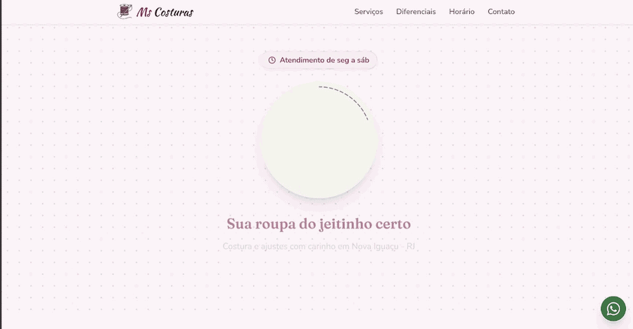
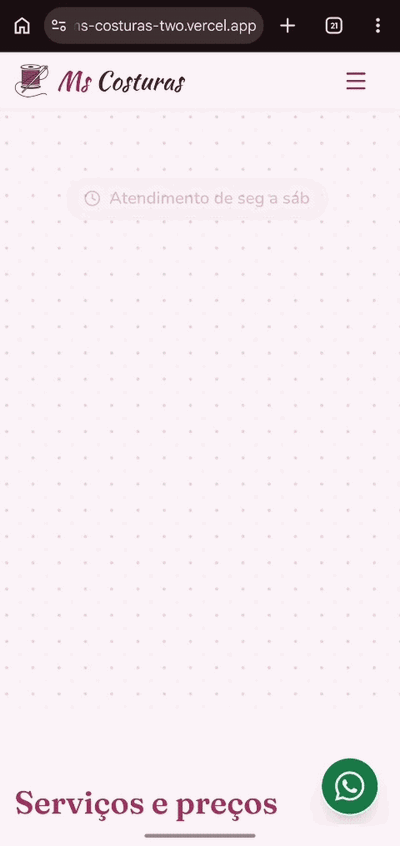

# Ms Costuras: Site Institucional

Landing page para a **Ms Costuras**, ateliê de costura e ajustes em Nova Iguaçu - RJ. O site divulga os serviços, preços e horários da loja e leva o cliente direto ao WhatsApp.

🔗 **Site no ar:** [ms-costuras-two.vercel.app](https://ms-costuras-two.vercel.app/)

## Preview

<p align="center">
  
  
</p>

## Sobre o projeto

Projeto desenvolvido como **atividade de extensão** do curso de Análise e Desenvolvimento de Sistemas (ADS) da **UNIG - Universidade Iguaçu**, no Tema Integrador "Gestão de Carreiras".

A proposta é levar presença digital a pequenos empreendedores da comunidade local, usando ferramentas de desenvolvimento assistido por Inteligência Artificial, versionamento com Git e deploy gratuito.

## Como o projeto foi feito

A primeira versão do site foi criada no [Lovable](https://lovable.dev), a partir de prompts. Depois disso, passei a desenvolver o projeto com o [Claude Code](https://claude.com/claude-code), da Anthropic, direto no repositório. Foi com ele que refinei o visual, a acessibilidade, as animações e o SEO/compartilhamento (veja as funcionalidades abaixo). As decisões de conteúdo e a revisão do resultado são minhas. O histórico completo está nos commits do GitHub.

## Parceira beneficiada

A Ms Costuras é uma loja de costura que atende vizinhos e moradores da região de Nova Iguaçu. Até então, os clientes chegavam apenas por indicação e boca a boca. O site centraliza serviços, preços, horário e localização em um só lugar, facilitando que novos clientes encontrem a loja.

## ODS atendida

**ODS 8 - Trabalho Decente e Crescimento Econômico:** digitalização de uma microempreendedora local, ampliando sua visibilidade e potencial de renda.

Relaciona-se também com a **ODS 10 - Redução das Desigualdades**, ao levar tecnologia a quem não teria recursos para contratar um desenvolvimento profissional.

## Funcionalidades

A página é única e tem estas seções, nesta ordem: início, serviços e preços, como funciona, diferenciais, horário e localização, contato e rodapé.

**Conteúdo e navegação**

- Menu fixo no topo, com menu em botão para o celular
- Serviços e preços em formato de "cardápio" (troca de zíper, ajuste para apertar, bainha, pence e bainha + pence), com os demais serviços sob consulta
- Seção "Como funciona" em 3 passos: traga a peça, combine o ajuste, retire na loja
- Diferenciais da loja: preço justo, rapidez e confiabilidade
- Horário de atendimento e mapa da localização

**Contato**

- Botões para o WhatsApp no início, no contato e no rodapé, com mensagem de orçamento já preenchida
- Botão flutuante de WhatsApp visível em todas as seções
- Link para o Instagram da loja

**Acessibilidade**

- Menu do celular fecha com a tecla Esc e devolve o foco ao botão
- Foco do teclado visível em links e botões
- Texto base de 18 px e alvos de toque de pelo menos 44 px
- Animações respeitam a preferência do sistema por movimento reduzido (`prefers-reduced-motion`)

**Desempenho e celular**

- Layout responsivo, pensado primeiro para o celular
- Logos em WebP e mapa com carregamento sob demanda (`loading="lazy"`)
- Página renderizada no servidor (SSR)

**Animações discretas**

- Logo que "se monta" ao carregar: o pesponto se costura ao redor, o nome surge como se fosse escrito à mão e a frase aparece por último
- Seções que aparecem suavemente ao rolar a página
- Linha pontilhada de "costura" desenhada sob os títulos
- Pulso no botão flutuante do WhatsApp ao carregar a página

**SEO e compartilhamento**

- Título e descrição da página, idioma `pt-BR` e `robots.txt`
- Open Graph com imagem de 1200x630, para a prévia do link aparecer no WhatsApp

## Tecnologias e ferramentas

| Ferramenta | Uso |
| --- | --- |
| [Lovable](https://lovable.dev) | Primeira versão do site, gerada com IA a partir de prompts |
| [Claude Code](https://claude.com/claude-code) | Desenvolvimento e refinamento do projeto |
| React 19 + TypeScript | Base do front-end |
| TanStack Start e Router | Estrutura do site, rotas e renderização no servidor (SSR) |
| Vite | Build e servidor de desenvolvimento |
| Tailwind CSS v4 | Estilização |
| Vitest | Testes automatizados |
| Git e GitHub | Versionamento e histórico do projeto |
| Vercel | Hospedagem e deploy |

## Como rodar localmente

Pré-requisito: Node.js instalado.

```bash
git clone https://github.com/LuisMiguelPerinotte/ms-costuras-landing-page.git
cd ms-costuras-landing-page
npm install
npm run dev
```

Outros comandos:

- `npm run build`: gera a versão de produção
- `npm run preview`: visualiza o resultado do build
- `npm test`: roda os testes

## Testes

```bash
npm test          # vitest run: roda todos os testes uma vez
npm run test:watch  # vitest: reexecuta ao salvar
```

Ambiente: [Vitest](https://vitest.dev) com jsdom e Testing Library (`@testing-library/react` e `jest-dom`). A configuração fica em `vitest.config.ts` e o `src/test/setup.ts` simula `window.scrollTo` e `window.matchMedia`, que o jsdom não implementa. Resultado atual: 2 arquivos e 3 testes, todos passando.

O que é testado:

| Arquivo | O que verifica |
| --- | --- |
| `src/test/app-routing.test.tsx` | O roteador reconhece a rota `/` e associa uma página a ela, em vez de cair na rota raiz (página não encontrada). Só a correspondência da rota é checada: nada é renderizado e os loaders não rodam. |
| `src/test/use-reveal.test.tsx` | O hook `useReveal` marca com `is-visible` os elementos `[data-costura]` e `[data-reveal]` que já estão na tela, observa os demais com `IntersectionObserver`, adiciona `reveal-ready` ao `<html>` e o remove ao desmontar. |
| `src/test/use-reveal.test.tsx` | Com `prefers-reduced-motion` ativo, o hook não adiciona `reveal-ready` nem observa nenhum elemento. |

O que ainda não é coberto por testes automatizados:

- Renderização e aparência das seções da página
- Animações CSS (costura, entrada em sequência, pesponto da logo, pulso)
- Foco e teclado, como o fechamento do menu com Esc
- Links de WhatsApp e Instagram
- Meta tags, incluindo Open Graph
- Responsividade (por exemplo, 360px de largura) e comportamento em navegadores reais
- Relatório de cobertura: não há provider de cobertura configurado

## Próximos passos

- Galeria de trabalhos realizados
- Sistema de avaliações de clientes, com back-end próprio
- Ampliar a cobertura de testes

## Autor

**Luís Miguel**: [LinkedIn](https://www.linkedin.com/in/luis-miguel-perinotte/) · [GitHub](https://github.com/LuisMiguelPerinotte)

Projeto de extensão orientado pelo professor Hamilcar Silva - UNIG, 2026.
